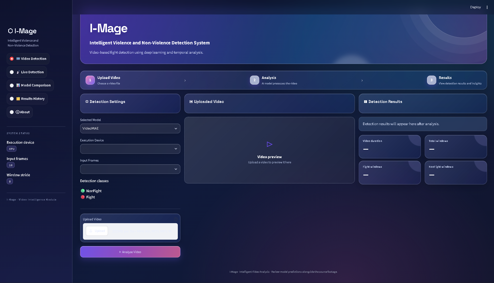
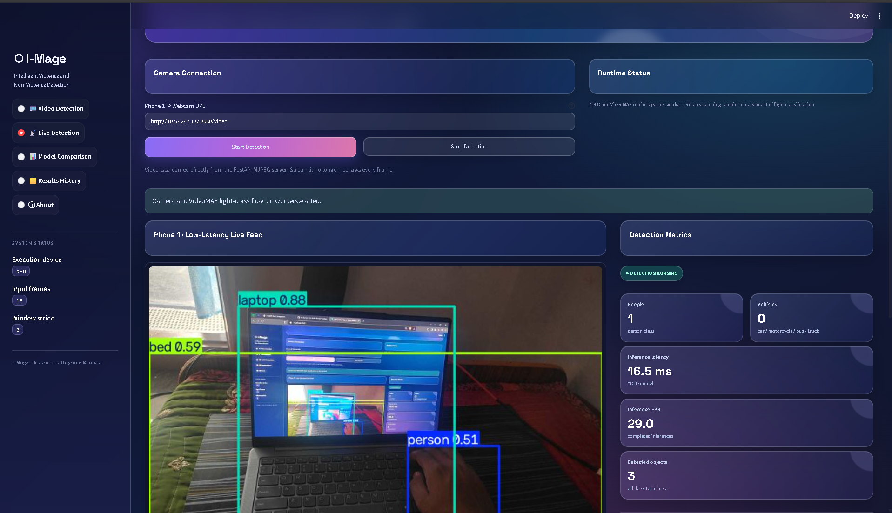
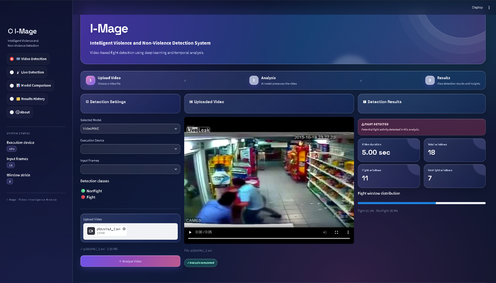
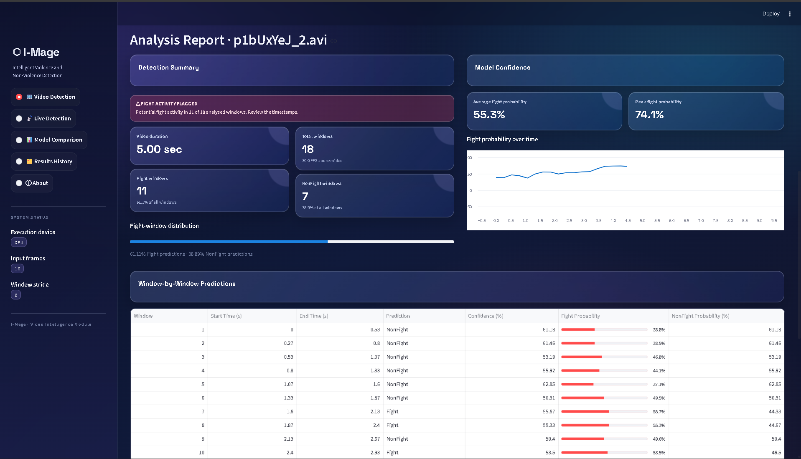

# I-Mage – Real-Time Fight and Non-Fight Detection System

## Overview

**I-Mage** is an AI-powered video surveillance system designed to detect violent activities in real time by classifying video footage into two categories: **Fight** and **Non-Fight**.

The system combines deep learning-based video classification and object detection to analyze video streams and identify potentially violent incidents. It supports uploaded video analysis as well as live camera monitoring.

The project focuses on improving surveillance monitoring through automated violence detection and real-time analysis.

## Key Features

- **Fight / Non-Fight Classification:** Classifies video footage into Fight or Non-Fight categories.
- **Video Analysis:** Processes uploaded videos and generates classification results.
- **Live Camera Detection:** Supports real-time video monitoring through a camera stream.
- **Object Detection:** Uses YOLO26n with OpenVINO for efficient object detection.
- **Deep Learning Models:** Implements R3D-18 and VideoMAE for video-based violence classification.
- **Model Evaluation:** Evaluates model performance using accuracy, precision, recall, F1-score, and ROC-AUC.
- **Model Comparison:** Provides functionality to compare different deep learning models.
- **Results History:** Maintains detection results for reviewing previous analyses.
- **GPU Acceleration:** Uses Intel XPU and OpenVINO GPU acceleration where supported.

## Technologies Used

| Category | Technologies |
|---|---|
| Programming Language | Python |
| Interface | Streamlit |
| Video Processing | OpenCV |
| Deep Learning | PyTorch |
| Video Classification | R3D-18, VideoMAE |
| Object Detection | YOLO26n |
| Inference Optimization | OpenVINO |
| GPU Acceleration | Intel XPU |
| Data Processing | NumPy, Pandas |

## System Architecture

The system follows a video-processing pipeline:

1. **Video Input:** Receives uploaded video files or live camera streams.
2. **Frame Extraction:** Extracts frames from the video stream.
3. **Object Detection:** YOLO26n detects objects using OpenVINO.
4. **Frame Buffering:** Maintains a rolling buffer of 16 frames for video classification.
5. **Violence Classification:** VideoMAE analyzes the frame sequence and predicts Fight or Non-Fight.
6. **Result Generation:** Produces classification results and detection metrics.
7. **Dashboard:** Displays analysis results through the Streamlit interface.

## Deep Learning Models

### 1. R3D-18

R3D-18 is a 3D convolutional neural network used for spatiotemporal video classification. It learns spatial and temporal features from video frames to distinguish fighting and non-fighting activities.

### 2. VideoMAE

VideoMAE is a video-based transformer model used for Fight/Non-Fight classification. It processes sequences of video frames to identify temporal patterns associated with violent activities.

### 3. YOLO26n

YOLO26n is used for object detection in the live video pipeline. OpenVINO optimizes its inference on supported Intel hardware.

## Dataset

The project uses the **RWF-2000 (Real-World Fighting) dataset** for Fight/Non-Fight classification.

Dataset composition:

| Split | Fight | Non-Fight | Total |
|---|---:|---:|---:|
| Training | 800 | 800 | 1,600 |
| Validation | 200 | 200 | 400 |
| **Total** | **1,000** | **1,000** | **2,000** |

The dataset contains real-world surveillance video clips categorized into Fight and Non-Fight classes.

**Note:** The dataset and trained model weights are not included in this repository because of their large file sizes.

## Project Structure

```text
Fight-Non-Fight/
│
├── app.py
├── live_server.py
├── export_yolo_openvino.py
├── requirements.txt
├── test_gpu.py
│
├── src/
│   ├── config.py
│   ├── dataset.py
│   ├── videomae_dataset.py
│   ├── train_r3d.py
│   ├── train_videomae.py
│   ├── evaluate_r3d.py
│   ├── evaluate_videomae.py
│   ├── detect_videomae.py
│   ├── live_yolo.py
│   ├── live_yolo_fast.py
│   ├── compare_models.py
│   ├── test_r3d.py
│   ├── test_videomae.py
│   ├── test_dataloader.py
│   └── verify_dataset.py
│
└── Model information/
    ├── 1.jpg
    ├── 2.jpg
    ├── 3.jpg
    └── 4.jpg
```

## Installation

### 1. Clone the Repository

```bash
git clone https://github.com/Shaik-pardi-11/AI-System-for-Multi-Modal-Campus-Safety-Incident-Analysis.git
```

### 2. Navigate to the Project

```bash
cd AI-System-for-Multi-Modal-Campus-Safety-Incident-Analysis
```

### 3. Create a Virtual Environment

```bash
python -m venv .venv
```

Activate it on Windows:

```powershell
.venv\Scripts\activate
```

### 4. Install Dependencies

```bash
pip install -r requirements.txt
```

### 5. Configure Dataset and Model Weights

Download the RWF-2000 dataset separately and configure its directory in the project configuration.

Place the required pretrained or trained model weights in the expected locations configured by the project.

## Running the Application

Start the Streamlit application:

```bash
streamlit run app.py
```

Open the local URL displayed in the terminal to access the application.

For live detection, configure the camera stream and run the live detection service using the project's `live_server.py` entry point.

## Hardware Acceleration

The project supports hardware-accelerated inference through Intel technologies.

- Intel Core Ultra processors
- Intel Arc integrated graphics
- PyTorch Intel XPU
- OpenVINO CPU and GPU inference

GPU acceleration depends on the installed drivers, runtime, and compatible software versions.

## Model Evaluation Metrics

The models are evaluated using:

- Accuracy
- Precision
- Recall
- F1-Score
- ROC-AUC
- Confusion Matrix

These metrics help assess classification performance and the ability to distinguish fighting from non-fighting activities.

## Future Enhancements

- Improve real-time detection speed and classification accuracy.
- Enhance live camera monitoring.
- Improve detection consistency across different lighting and camera conditions.
- Add more robust incident logging and reporting.
- Support integration with larger campus surveillance systems.


## Application Screenshots

### 1. Main Dashboard

The I-Mage dashboard provides access to video detection, live camera monitoring, model comparison, and detection history.



---

### 2. Live Detection

Real-time camera monitoring with YOLO26n object detection, live inference metrics, and VideoMAE-based fight classification.



---

### 3. Video Detection

Analyzes uploaded surveillance videos and identifies potential fight activity.



---

### 4. Analysis Report

Displays fight probability, classification distribution, video analysis metrics, and window-by-window predictions.



## Author

**Shaik Mohammad Pardeen**

B.Tech – Computer Science and Engineering (AI & ML)

GitHub: [Shaik-pardi-11](https://github.com/Shaik-pardi-11)

## License

This project is developed for academic and research purposes.
